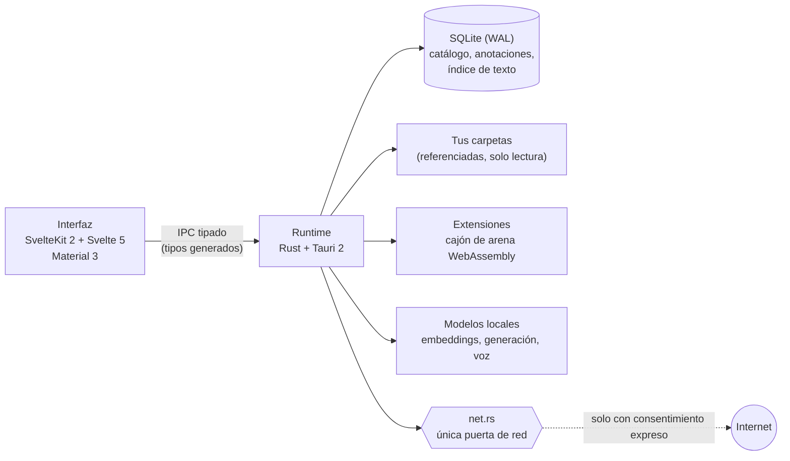
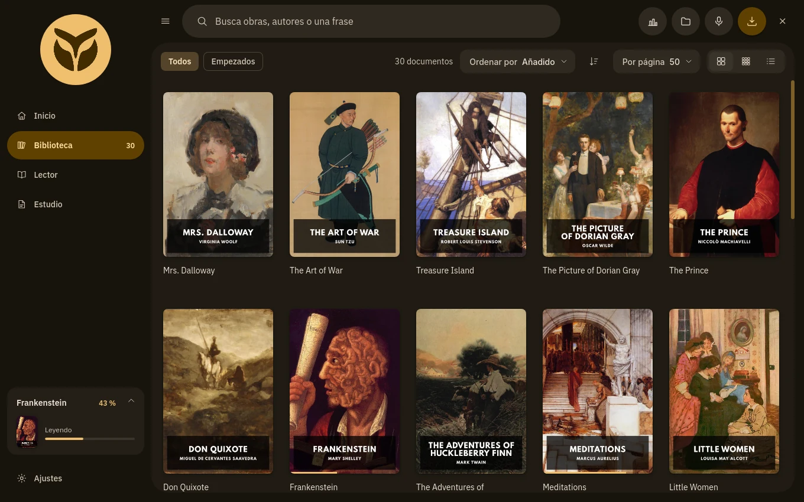
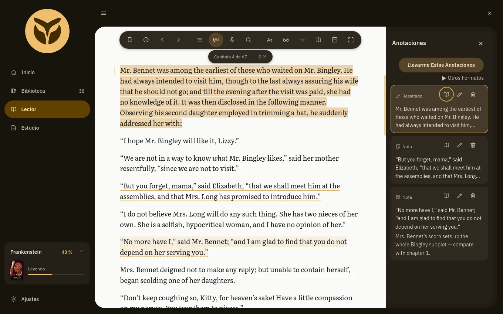
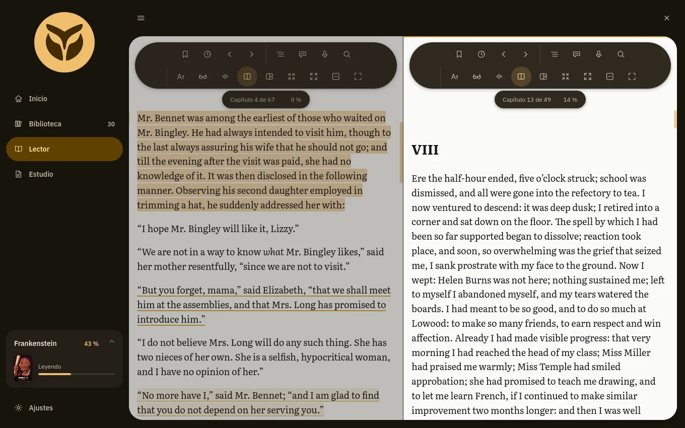
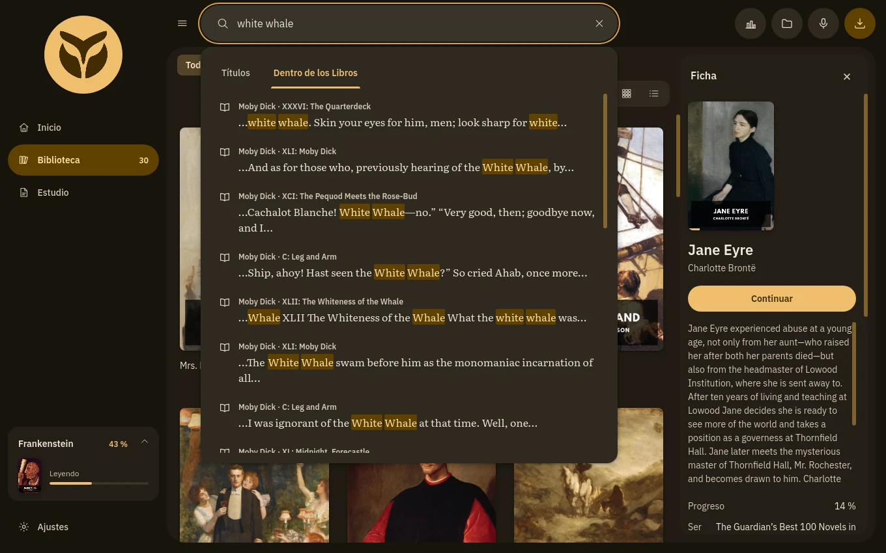
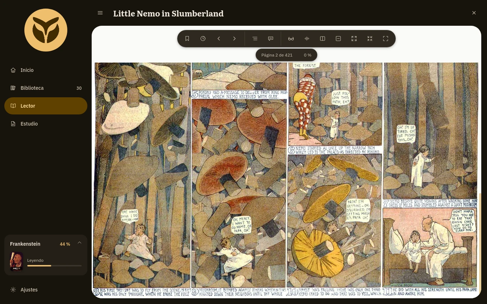
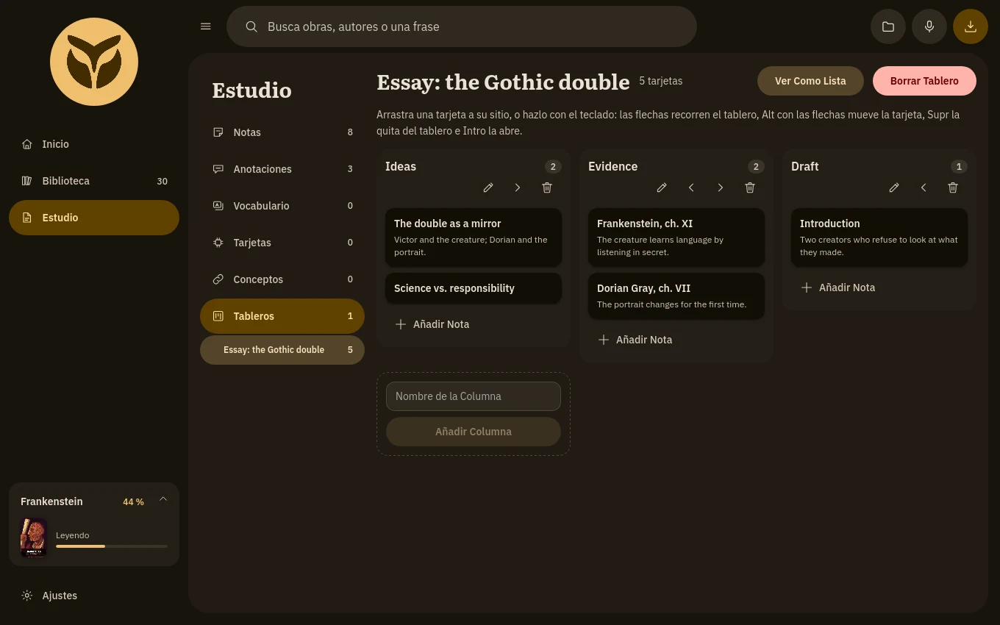
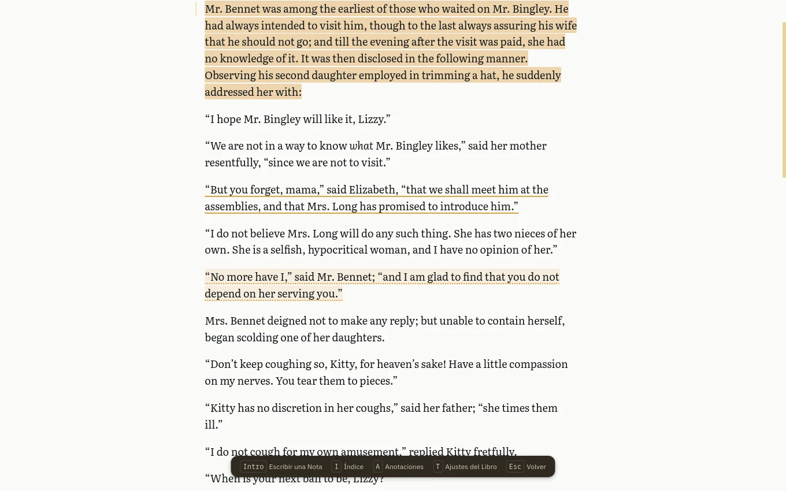
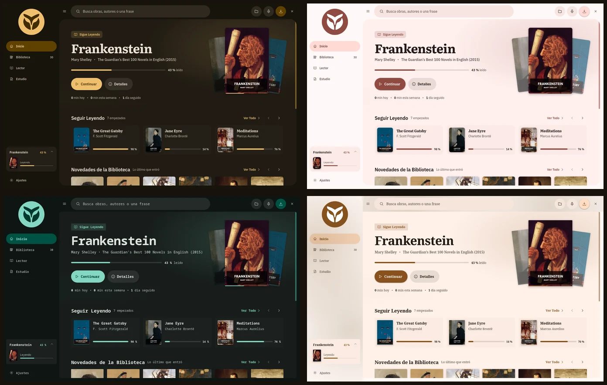

# NB Books

<p align="center">
  
</p>

<p align="center">
  <strong>Lee, organiza y estudia toda tu biblioteca. En tu equipo, y en ningún otro sitio.</strong>
</p>

<p align="center">
  <a href="LICENSE"></a>
  
  
  
  
  
</p>

<p align="center">
  <a href="README.md">English</a> · <strong>Español</strong>
</p>

---

## TL;DR

NB Books es una aplicación de escritorio libre y gratuita que reúne lo que normalmente está repartido entre un
gestor de biblioteca, un lector de EPUB, un lector de PDF, un diccionario, un traductor y una aplicación de notas.
Maneja bibliotecas de **cientos de miles de documentos** sin congelarse, deja cada archivo donde lo pusiste,
funciona **sin conexión**, no pide **ninguna cuenta** y no envía **nada** a ninguna parte salvo que autorices de
forma expresa un servidor concreto para un propósito concreto. Forma parte de la suite comunitaria de NB Digital,
bajo licencia Apache 2.0.

## Por qué NB Books

Leer y estudiar en digital suele obligar a alternar cinco herramientas que no se hablan entre sí, una cuenta en la
nube que retiene tus notas y un gestor que copia tus archivos a sus propias carpetas. NB Books elimina la fricción
entre esas herramientas en lugar de competir con cada una función por función:

* **Tus archivos se quedan donde están.** Las carpetas se referencian, no se copian. Nada se duplica, renombra ni
  mueve.
* **Tus notas son tuyas.** Resaltados y anotaciones se anclan al texto, sobreviven a reimportaciones y a nuevas
  ediciones, y se exportan a formatos abiertos.
* **Pensada para bibliotecas grandes.** Ordenar, filtrar y buscar ocurren en SQLite, los resultados siempre están
  acotados y lo derivado (índice, portadas) tiene un tope proporcional al tamaño de la biblioteca.

## Funcionalidades

| Área | Qué ofrece |
|---|---|
| **Lectura** | EPUB, PDF y cómics (CBZ) en un mismo lector; modos paginado y continuo; vista dividida; modo inmersivo; tipografía por libro; índice y "dónde estoy" para lectores de pantalla |
| **Biblioteca** | Carpetas referenciadas, identidad por contenido (un archivo movido o renombrado sigue siendo la misma obra), duplicados, estanterías, colecciones, autores, series, materias y etiquetas |
| **Metadatos** | Metadatos internos de EPUB, importación de bibliotecas de Calibre, consulta opcional de portadas y metadatos en línea (con consentimiento) |
| **Anotaciones** | Resaltados, subrayados, trazos, marcadores y notas, anclados con localizadores independientes de la paginación; exportación de anotaciones |
| **Estudio** | Notas propias enlazadas con retroenlaces, tableros de notas por columnas, vocabulario de las palabras consultadas, repaso espaciado |
| **Búsqueda** | Texto completo en toda la biblioteca y dentro de un documento; búsqueda semántica opcional con un modelo local |
| **Consulta** | Diccionarios sin conexión (StarDict); enciclopedia y traducción cuando lo autorizas |
| **Lectura en voz alta** | Voces del sistema por Speech Dispatcher, una voz neuronal local y audio preparado por adelantado para libros enteros |
| **IA local (opcional)** | Modelos de embeddings y generativos que corren en tu CPU, descargados solo si los pides; proveedores externos solo si los configuras |
| **Descubrir** | Catálogos OPDS, cada servidor autorizado por separado |
| **Extensiones** | Cajón de arena WebAssembly con permisos declarados: lectores, temas, fuentes de consulta, comandos y vistas |
| **Interfaz** | Diseño Material 3, temas claros y oscuros con un tema papel de bajo contraste, español, inglés y portugués, navegación completa por teclado |
| **Portabilidad** | Exportación e importación del estado completo de la biblioteca; paquete de diagnóstico redactado por diseño |

## Garantías de privacidad

NB Books sigue un modelo **local-first**, y estas garantías las hacen cumplir el código y comprobaciones
automáticas, no las promesas. La declaración completa está en [PRIVACY.md](PRIVACY.md) (en inglés) y en
[docs/audit/privacy.md](docs/audit/privacy.md).

* **Cero telemetría.** Sin analítica, sin informes de fallos, sin seguimiento de uso. Los registros se quedan en tu
  disco y están redactados: nunca contienen rutas, títulos, autores ni texto de tus documentos.
* **Una sola puerta de red.** Toda conexión saliente pasa por un único módulo que comprueba el modo sin red y un
  consentimiento por servidor y propósito; sin consentimiento no sale nada. Cualquier cliente de red fuera de ese módulo hace fallar la
  verificación.
* **Sin cuenta ni muros de pago.** Todas las funciones funcionan sin iniciar sesión.
* **Tus secretos en tu llavero.** Las claves de servicios opcionales se guardan en el llavero del sistema operativo.

## Arquitectura resumida



Más detalle en [docs/architecture](docs/architecture/README.md).

## Capturas y vídeo

[](docs/assets/video/nb-books-demo-es.mp4)

*Un recorrido de 45 segundos hecho solo con capturas reales de la aplicación ([MP4](docs/assets/video/nb-books-demo-es.mp4)).*

| Inicio | Biblioteca | Lector |
|---|---|---|
|  |  |  |

| Vista dividida | Búsqueda en el texto | Cómics y PDF |
|---|---|---|
|  |  |  |

| Estudio | Lectura inmersiva | Temas |
|---|---|---|
|  |  |  |

La biblioteca de estas imágenes son libros de dominio público de [Standard Ebooks](https://standardebooks.org) y del
[Internet Archive](https://archive.org).

## Instalación rápida (Linux)

Descarga el paquete de tu distribución desde la página de publicaciones y compruébalo contra `SHA256SUMS` y su
firma Ed25519 `SHA256SUMS.sig` (ver [publicaciones](docs/developer/deployment/releases.md)).

| Distribución | Paquete |
|---|---|
| Debian, Ubuntu y derivadas | `.deb` |
| Fedora, openSUSE y derivadas | `.rpm` |
| Arch y cualquier otra distribución | `.tar.gz` (usa el WebKitGTK del sistema) |
| Portátil, sin instalación | AppImage |

Para compilar desde el código fuente:

```bash
just setup      # o: pnpm install && pnpm exec playwright install chromium && pnpm pdfium
just dev        # ejecutar en modo desarrollo
just package-linux
```

Requisitos y detalles: [entorno de desarrollo](docs/developer/setup.md) y
[distribución en Linux](docs/developer/deployment/linux.md).

## Documentación

| Si quieres... | Lee |
|---|---|
| Usar la aplicación | [Guía de usuario](docs/user/README.md) |
| Evaluarla para una institución | [Institución](docs/institution/README.md) |
| Entender cómo está construida | [Arquitectura](docs/architecture/README.md) |
| Saber por qué está construida así | [ADR](docs/adr/README.md) |
| Contribuir | [CONTRIBUTING.md](CONTRIBUTING.md) y [guía de desarrollo](docs/developer/README.md) |
| Trabajar en ella con un agente de IA | [AGENTS.md](AGENTS.md) |

## Contribuir, seguridad y conducta

Las contribuciones son bienvenidas bajo el Developer Certificate of Origin (`git commit -s`); ver
[CONTRIBUTING.md](CONTRIBUTING.md). Las vulnerabilidades se reportan en privado según [SECURITY.md](SECURITY.md).
La participación se rige por el [Código de conducta](CODE_OF_CONDUCT.md).

## Licencia y marcas

Apache License 2.0; ver [LICENSE](LICENSE) y [NOTICE](NOTICE). Los nombres "NB", "NB Digital" y "NB Books" y sus
logotipos no se licencian bajo Apache 2.0; ver [TRADEMARKS.md](TRADEMARKS.md). Para citar el proyecto, usa
[CITATION.cff](CITATION.cff).
