# NB Books

<p align="center">
  
</p>

<p align="center">
  <strong>Read, organise and study your whole library. On your machine, and nowhere else.</strong>
</p>

<p align="center">
  <a href="LICENSE"></a>
  
  
  
  
  
</p>

<p align="center">
  <strong>English</strong> · <a href="README.es.md">Español</a>
</p>

---

## TL;DR

NB Books is a free, open-source desktop application that brings together what is usually spread across a library
manager, an EPUB reader, a PDF reader, a dictionary, a translator and a notes app. It handles libraries of
**hundreds of thousands of documents** without freezing, keeps every file where you put it, works **fully
offline**, requires **no account**, and sends **nothing** anywhere unless you explicitly allow a specific host for
a specific purpose. It is part of the NB Digital community suite, under the Apache 2.0 licence.

## Why NB Books

Reading and studying digitally usually means juggling five tools that do not talk to each other, a cloud account
that holds your notes hostage, and a library manager that copies your files into its own folders. NB Books
replaces the friction between those tools rather than competing with each one feature by feature:

* **Your files stay where they are.** Folders are referenced, not copied. Nothing is duplicated, renamed or moved.
* **Your notes are yours.** Highlights and annotations are anchored to the text, survive re-imports and new
  editions, and export to open formats.
* **Built for large libraries.** Sorting, filtering and search run in SQLite, results are always bounded, and
  derived data (index, covers) is capped at a fraction of the library's size.

## Features

| Area | What you get |
|---|---|
| **Reading** | EPUB, PDF and comic archives (CBZ) in one reader; paginated and scroll modes; split view; immersive mode; per-book typography; table of contents and "where am I" for screen readers |
| **Library** | Referenced folders, content-based identity (a file moved or renamed is still the same work), duplicate detection, shelves, collections, authors, series, subjects and tags |
| **Metadata** | Internal EPUB metadata, Calibre library import, optional online lookup of covers and metadata (with consent) |
| **Annotations** | Highlights, underlines, strokes, bookmarks and notes, anchored by position-independent locators; export of annotations |
| **Study** | Linked personal notes with backlinks, note boards with named columns, vocabulary from looked-up words, spaced repetition |
| **Search** | Full-text search across the library and inside a document; optional semantic search with a local model |
| **Look up** | Offline dictionaries (StarDict); encyclopedia and translation when you allow it |
| **Read aloud** | System voices through Speech Dispatcher, a local neural voice, and audio prepared in advance for whole books |
| **Local AI (optional)** | Local embedding and generative models running on your CPU, downloaded only on request; external providers only if you configure them |
| **Discover** | OPDS catalogues, each host authorised separately |
| **Extensions** | WebAssembly sandbox with declared permissions: readers, themes, look-up sources, commands and views |
| **Interface** | Material 3 design, light and dark themes including a low-contrast paper theme, Spanish, English and Portuguese, full keyboard navigation |
| **Portability** | Export and import of the entire library state; diagnostics bundle redacted by design |

## Privacy guarantees

NB Books follows a **local-first** model, and these guarantees are enforced by code and by automated checks,
not by promises. The full statement is in [PRIVACY.md](PRIVACY.md).

* **Zero telemetry.** No analytics, no crash reporting, no usage tracking. Logs stay on your disk and are redacted:
  they never contain paths, titles, authors or text from your documents.
* **One network gate.** Every outgoing connection passes through a single module that checks offline mode and a
  per-host, per-purpose consent; with no consent, nothing leaves. Any network client outside that module fails the
  build checks.
* **No account, no paywall.** Every feature works without signing in.
* **Your secrets in your keyring.** API keys for optional services are stored in the operating system's keyring.

## Architecture at a glance

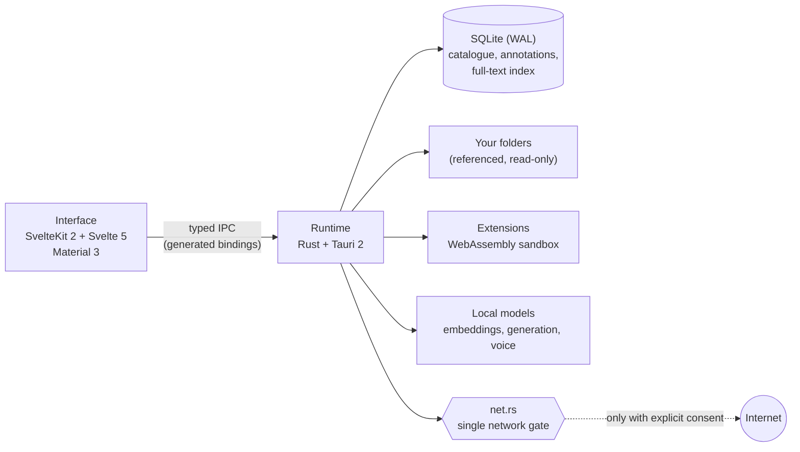

More detail in [docs/architecture](docs/architecture/README.md) (Spanish).

## Screenshots and video

[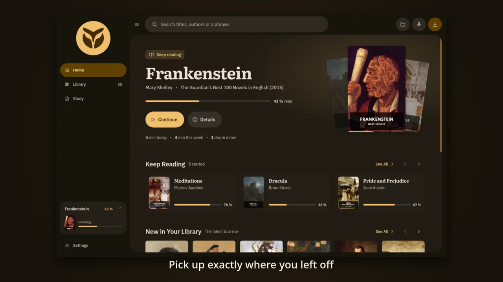](docs/assets/video/nb-books-demo.mp4)

*A 45-second tour, made only from real screenshots of the application ([MP4](docs/assets/video/nb-books-demo.mp4)).*

| Home | Library | Reader |
|---|---|---|
| 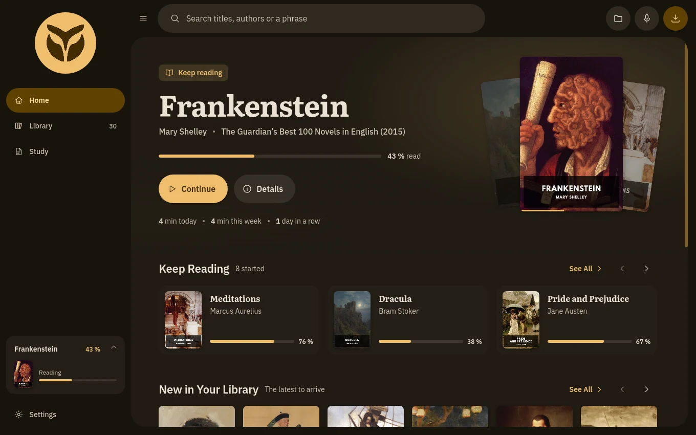 | 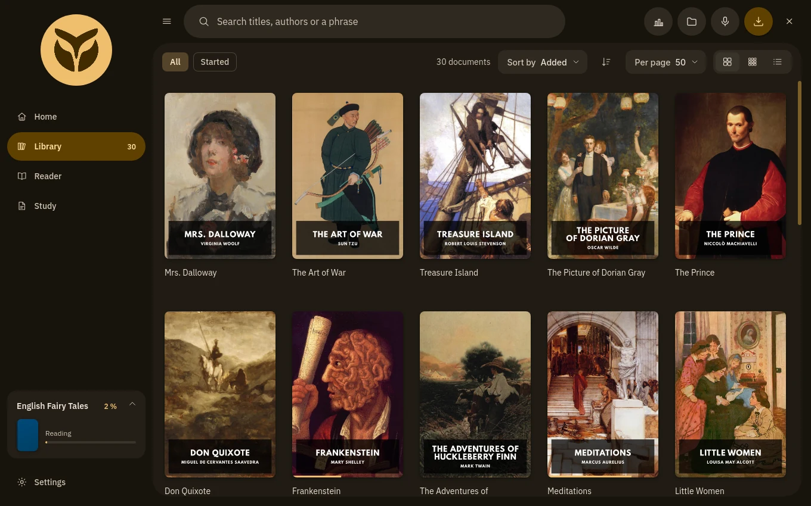 | 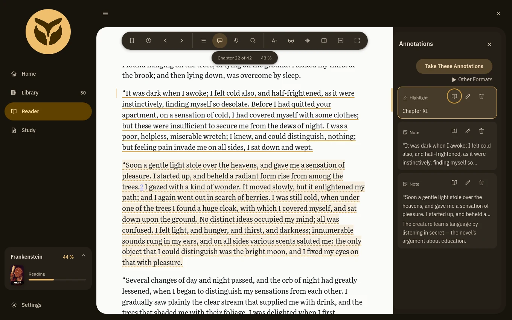 |

| Split view | Full-text search | Comics and PDF |
|---|---|---|
| 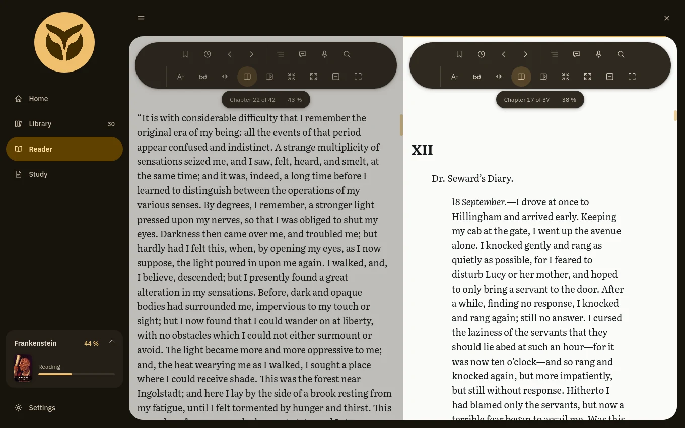 | 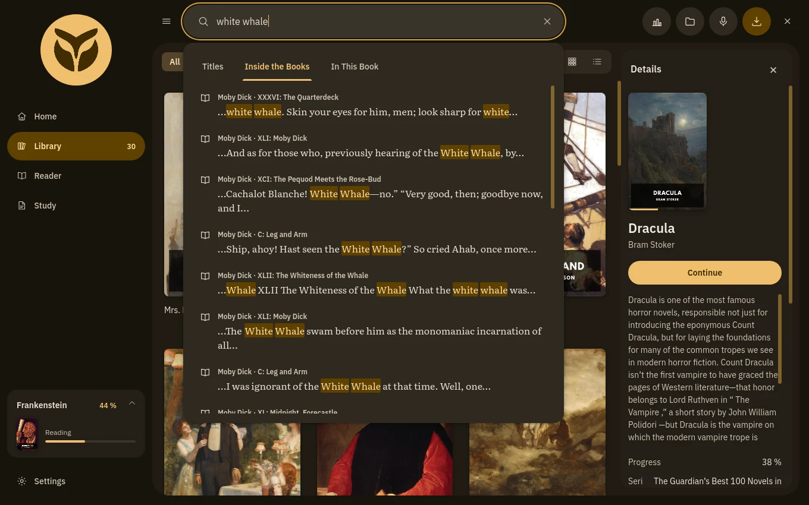 | 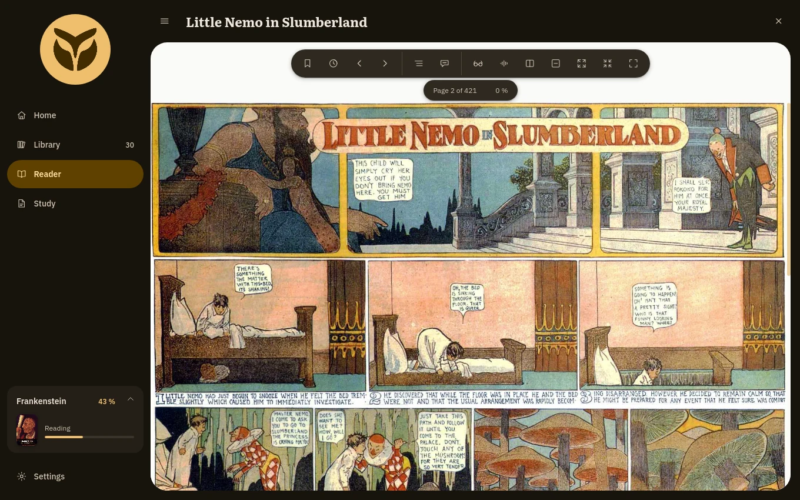 |

| Study | Immersive reading | Themes |
|---|---|---|
| 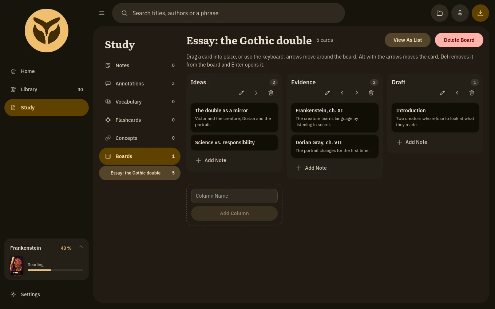 | 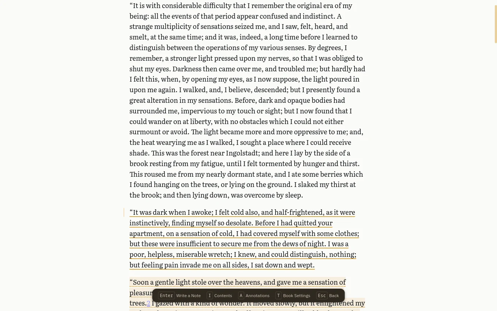 | 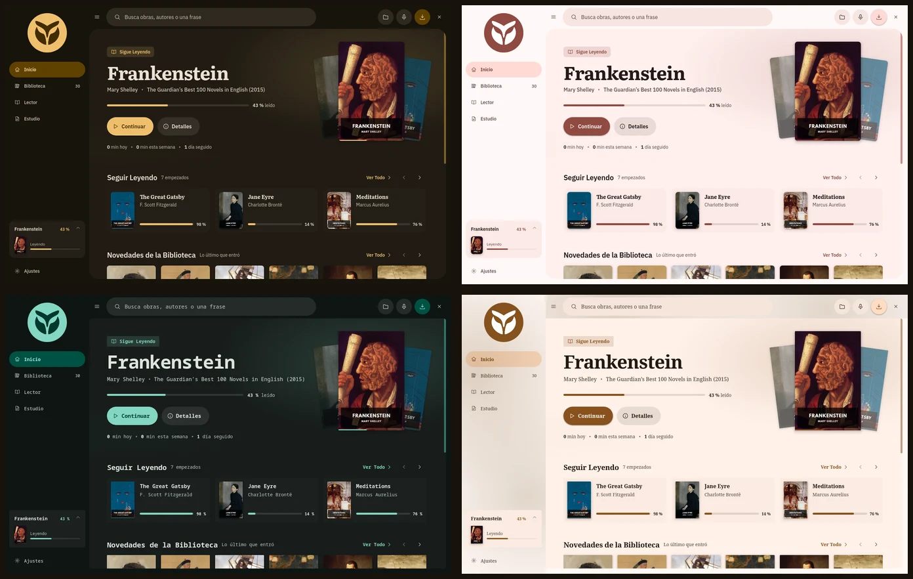 |

The library in these images is made of public-domain books from [Standard Ebooks](https://standardebooks.org) and
the [Internet Archive](https://archive.org).

## Quick install (Linux)

Download the package for your distribution from the release page and verify it against `SHA256SUMS` and its
Ed25519 signature `SHA256SUMS.sig` (see [releases](docs/developer/deployment/releases.md)).

| Distribution | Package |
|---|---|
| Debian, Ubuntu and derivatives | `.deb` |
| Fedora, openSUSE and derivatives | `.rpm` |
| Arch and any other distribution | `.tar.gz` (uses the system WebKitGTK) |
| Portable, no installation | AppImage |

To build from source:

```bash
just setup      # or: pnpm install && pnpm exec playwright install chromium && pnpm pdfium
just dev        # run in development mode
just package-linux
```

Requirements and details: [developer setup](docs/developer/setup.md) and
[Linux deployment](docs/developer/deployment/linux.md).

## Documentation

| If you want to... | Read |
|---|---|
| Use the application | [User guide](docs/user/README.md) |
| Evaluate it for an institution | [Institution](docs/institution/README.md) |
| Understand how it is built | [Architecture](docs/architecture/README.md) |
| Know why it is built this way | [ADR](docs/adr/README.md) |
| Contribute | [CONTRIBUTING.md](CONTRIBUTING.md) and [developer guide](docs/developer/README.md) |
| Work on it with an AI agent | [AGENTS.md](AGENTS.md) |

## Contributing, security and conduct

Contributions are welcome under the Developer Certificate of Origin (`git commit -s`); see
[CONTRIBUTING.md](CONTRIBUTING.md). Report vulnerabilities privately as described in [SECURITY.md](SECURITY.md).
Participation is governed by the [Code of Conduct](CODE_OF_CONDUCT.md).

## Licence and trademarks

Apache License 2.0; see [LICENSE](LICENSE) and [NOTICE](NOTICE). The names "NB", "NB Digital" and "NB Books" and
their logos are not licensed under Apache 2.0; see [TRADEMARKS.md](TRADEMARKS.md). To cite the project, use
[CITATION.cff](CITATION.cff).
