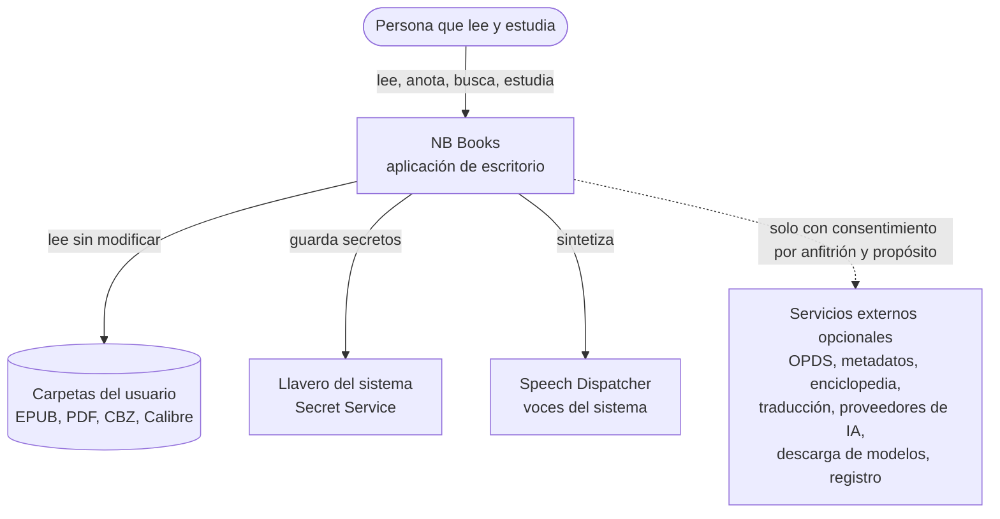
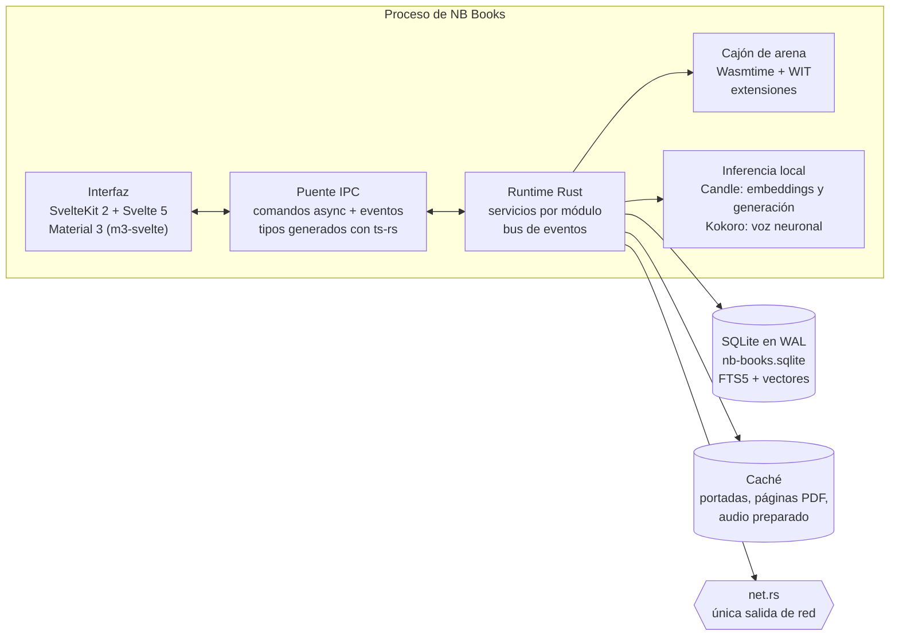
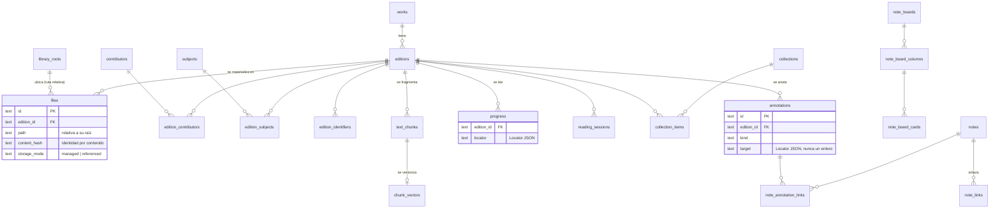

# Arquitectura

> **Estado:** Implementado. Cada documento enlazado declara su propio estado en sus primeras líneas, según la
> [convención general](../README.md).

NB Books es una aplicación de escritorio **local-first**: un runtime en Rust sobre Tauri 2 que contiene toda la
lógica y los datos, y una interfaz SvelteKit 2 / Svelte 5 servida como sitio estático dentro de un webview
(WebKitGTK en Linux). La interfaz no tiene estado propio que importe: todo lo que el usuario posee vive en una
base SQLite local y en sus propias carpetas.

## 1. Contexto (C4, nivel 1)

## 2. Contenedores (C4, nivel 2)

| Contenedor | Tecnología | Responsabilidad |
|---|---|---|
| Interfaz | SvelteKit 2, Svelte 5, adaptador estático, `m3-svelte` | Presentación, navegación por teclado, i18n. Invoca el runtime solo a través de `src/lib/core/ipc` |
| Puente IPC | Tauri 2 `invoke` y eventos | Frontera de seguridad. Todos los comandos son asíncronos, devuelven códigos de error canónicos y colecciones acotadas |
| Runtime | Rust, `rusqlite`, `ureq` (solo dentro de `net.rs`) | Biblioteca, lectura, anotaciones, búsqueda, notas, IA, voz, extensiones, red y portabilidad |
| Cajón de arena | Wasmtime con el mundo `src-tauri/wit/nb-extension.wit` | Ejecutar extensiones de terceros con capacidades concedidas una a una |
| Inferencia local | Candle (Rust puro), modelos del catálogo revisado | Embeddings para búsqueda semántica, generación para funciones de estudio, voz neuronal |
| Base de datos | SQLite en modo WAL, transacciones `BEGIN IMMEDIATE` | Catálogo, anotaciones, progreso, notas, índice de texto completo y vectores |

## 3. Esquema de datos (núcleo)

El esquema completo lo definen las migraciones embebidas en `src-tauri/migrations/` y su cara tipada es
`src-tauri/src/db/catalog.rs`. El diagrama muestra el núcleo bibliográfico y de lectura; ver
[storage](storage.md), [metadata-model](metadata-model.md) y [migrations](migrations.md).

Tablas de soporte: `settings`, `network_consents` y `network_log` (puerta de red), `catalogs` (OPDS),
`metadata_provenance` y `metadata_suggestions`, `import_runs`, `import_duplicates` e `import_rejections`,
`documents_fts` y `catalog_fts` (FTS5), `search_status` e `index_probes`, `vocabulary`, `study_cards`,
`concepts`, `ai_reports` y `ai_sends`, `audio_sections` y `audio_marks`, `extension_withdrawals`,
`vector_excluded_editions` y `vector_excluded_collections`, `shelf_counts` y `app_metadata`.

## 4. Documentos

### Fundamentos

| Documento | Contenido |
|---|---|
| [Constitución](constitution.md) | Las reglas absolutas del producto |
| [Glosario](glossary.md) | Vocabulario común del dominio |
| [Modelo de documento](document-model.md) | Obra, edición, archivo y documento |
| [System overview](system-overview.md) | Runtime, interfaz y arquitectura orientada a servicios |
| [Component model](component-model.md) | Contratos, capacidades y máquina de estados de salud |
| [Event bus](event-bus.md) | Publicación y suscripción interna |
| [Data flows](data-flows.md) | Recorridos completos de los datos |

### Contratos

| Documento | Contenido |
|---|---|
| [IPC contracts](ipc-contracts.md) | Reglas del puente: asincronía, errores, colecciones acotadas |
| [Reader contracts](reader-contracts.md) | Locator y abstracción de formatos |
| [Versioning](versioning.md) | Contratos versionados y su compatibilidad |
| [API](api/README.md) | Eventos, servicios, esquemas, formato de exportación y API de extensiones |

### Datos

| Documento | Contenido |
|---|---|
| [Storage](storage.md) | SQLite, raíces de biblioteca, bibliotecas referenciadas y administradas, Calibre |
| [Metadata model](metadata-model.md) | Modelo bibliográfico, procedencia e interoperabilidad |
| [Migrations](migrations.md) | Evolución del esquema sin pérdida de datos |
| [Search](search.md) | Búsqueda léxica, alcances, cotas y presupuesto del índice |

### Interfaz

| Documento | Contenido |
|---|---|
| [UI components](ui-components.md) | Carcasa, vistas, modos de lectura y puntos de extensión |
| [State management](state-management.md) | Clasificación del estado y fuente de verdad |
| [Accessibility](accessibility.md) | Accesibilidad en un webview |
| [i18n](i18n.md) | Internacionalización y localización |

### Capacidades

| Documento | Contenido |
|---|---|
| [AI](ai/README.md) | Filosofía, modelos locales, embeddings, prompts, evaluación y privacidad de la IA |
| [Voice services](voice-services.md) | Voces del sistema, voz neuronal y audio preparado |
| [Plugin system](plugin-system.md) | Cajón de arena WebAssembly, manifiesto y almacén |
| [Security](security/README.md) | Autenticación de servicios, autorización y cifrado |

### Restricciones transversales

| Documento | Contenido |
|---|---|
| [Performance budgets](performance-budgets.md) | Límites de rendimiento y almacenamiento derivado |
| [Optimization catalog](optimization-catalog.md) | Qué está optimizado y medido |
| [Dependency policy](dependency-policy.md) | Criterios de aprobación de dependencias y licencias |
