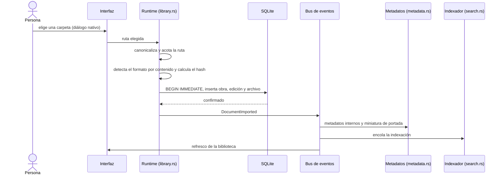
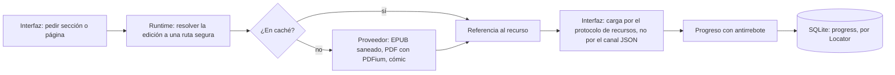
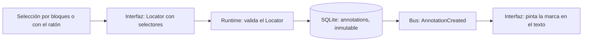
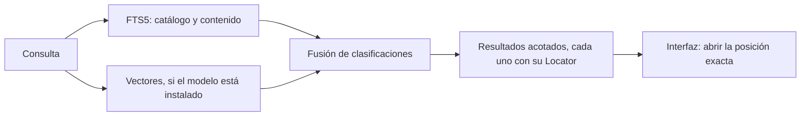
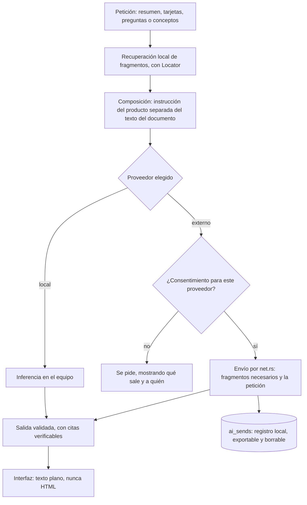
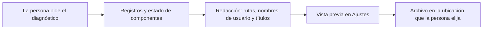

# Flujos de datos

> **Estado:** Implementado. Traza los recorridos completos de los datos entre la interfaz, el runtime, el disco y
> la red, para revisar dónde se validan, dónde se persisten y dónde podrían filtrarse.

## 1. Importación de un documento

Puntos de control:

* La transacción se confirma antes de emitir el evento; ningún consumidor observa estado a medias.
* En modo referenciado se guarda la ruta **relativa a su raíz de biblioteca** y el hash; el archivo no se copia ni
  se modifica.
* Un archivo inválido no deja registro huérfano. Las copias exactas se cuentan aparte y no entran dos veces.
* **Una sola importación masiva a la vez.** Pedir otra mientras hay una en marcha responde `running: true` y la
  interfaz muestra el avance de la que hay.
* **El avance dice el total desde el primer aviso**: la carpeta se recorre entera antes de importar nada.
* **La indexación cede el paso mientras entra una importación**, y se reanuda al terminar. Con mil documentos
  reales, la peor lectura de la interfaz baja de 3,3 a 1,4 ms y la importación de 9,3 a 7,9 s.

## 2. Lectura de un documento

* El progreso se guarda con antirrebote, y cerrar o salir del lector escribe lo pendiente.
* **Un documento que nunca se ha leído se abre por la primera sección con texto de verdad** (doscientos caracteres
  visibles, mirando como mucho doce secciones), no por la cubierta. Si no la hay, se abre por la primera.
* Las páginas de PDF y cómic se sirven desde la caché de la aplicación; ningún archivo del usuario es alcanzable
  por el protocolo de recursos.

## 3. Anotación

Una anotación es inmutable (migración V7): editarla es darla de baja y crear otra con nuevo identificador, que
conserva su historia y simplifica el reanclaje.

## 4. Búsqueda

El filtrado nunca ocurre en JavaScript sobre colecciones completas.

### 4.1 Recorrer por facetas

Un panel de autores, series o materias no agrupa el catálogo: cada estantería tiene su recuento al día en
`shelf_counts`, que mantienen los disparadores de la migración V24, y el panel lo lee por un índice de cobertura.
Para saber cuáles son las veinte estanterías mayores habría que contar todas, porque `LIMIT` recorta el resultado
y no el trabajo: con 55.740 autores eran 4.141 ms, y materializado son 6.

Las bajas cuelgan de las tablas de enlace, porque en la versión de SQLite que se compila (3.53.4) la cascada sí
dispara los disparadores. `tests/estanterias.rs` lo comprueba, así que una versión futura que cambie ese
comportamiento hace fallar la suite.

## 5. Funciones de estudio con IA

Nunca sale un documento completo, y el primer envío a un proveedor nuevo muestra exactamente qué se enviaría.

## 6. Diagnóstico

El envío nunca es automático.
