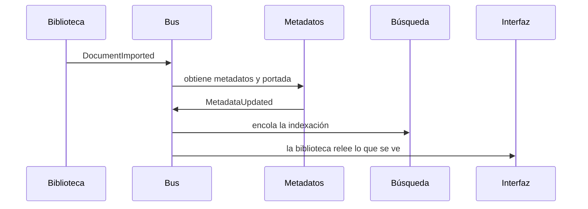

# Visión general del sistema

> **Estado:** Implementado. Un módulo por servicio en `src-tauri/src/`.

NB Books sustituye la idea de un monolito por **un runtime pequeño y contratos estables sobre los que viven
componentes independientes**.

## Arquitectura de alto nivel

El sistema son dos mundos separados por el puente de Tauri 2:

1. **El runtime (Rust).** Entrada y salida pesadas, base de datos local, archivos, seguridad, red, inferencia local,
   voz, indexación y extensiones.
2. **La interfaz (Svelte 5 y TypeScript).** Con runes, implementa la carcasa de paneles y vistas de
   [ADR-012](../adr/012-ui-paradigm.md). Pinta, recoge la interacción y pide operaciones al runtime. **No contiene
   lógica de negocio pesada.**

Esta frontera es también la frontera de seguridad. Ver [ipc-contracts.md](ipc-contracts.md).

## Componentes

Los módulos viven en `src-tauri/src/`, salvo los del motor de lectura, que forman el crate `src-tauri/lector/`.
La aplicación los vuelve a exponer con los mismos nombres (`crate::error`, `crate::reader::locator`), de modo
que el resto del código no distingue dónde están.

| Componente | Módulos | Responsabilidad |
|---|---|---|
| Biblioteca | `library.rs`, `browse.rs`, `collections.rs`, `imports.rs`, `repaso.rs`, `calibre.rs` | Documentos, raíces, recorrido, colecciones, importación y repaso de carpetas |
| Metadatos | `metadata.rs`, `metadata_online.rs`, `covers.rs`, `epub.rs` | Metadatos internos y en línea, procedencia y portadas |
| Búsqueda | `search.rs` | Índice léxico, sondas y cola de indexación |
| Lector | `lector/` (crate), `reader/` | El motor de lectura —Locator, proveedores de EPUB, PDF y cómic, saneador, lector de ZIP y códigos de error— es un crate propio que comparte NB Books Mobile; `reader/` añade la sesión y el progreso guardado |
| Anotaciones y estudio | `annotations.rs`, `notes.rs`, `boards.rs`, `vocabulary.rs`, `repaso.rs` | Anotaciones, notas enlazadas, tableros, vocabulario y repaso |
| Consulta | `lookup/` | Diccionarios StarDict, enciclopedia y traducción |
| Voz | `voice/`, `speech.rs` | Voz del sistema, voz neuronal, voz de un servicio y audio preparado |
| IA | `ai/` | Embeddings, generación local, proveedores externos y presupuesto |
| Extensiones | `extensions.rs`, `extensions/` | Cajón de arena, manifiesto, almacén, permisos y revisión |
| Red | `net.rs`, `opds.rs`, `actualizacion.rs` | Única puerta de salida, catálogos OPDS y actualizaciones |
| Plataforma | `db/`, `events.rs`, `monitor.rs`, `settings.rs`, `secrets.rs`, `paths.rs`, `telemetry.rs`, `portability.rs`, `diagnostics.rs` | Persistencia, bus de eventos, salud de componentes, preferencias, credenciales, rutas, registro, exportación y diagnóstico |

### Sin punto único de fallo

Un fallo local produce consecuencias locales:

* La comunicación entre servicios no es acoplamiento duro.
* Sin motor de PDF, el resto de formatos sigue siendo legible.
* Con la IA caída, la búsqueda léxica, la lectura y la anotación siguen igual.
* Un volumen desconectado deja sus documentos como no disponibles, sin perder metadatos ni anotaciones.

La propiedad se verifica con la [suite de caos](../developer/testing/chaos.md).

## Comunicación por eventos

Los componentes se comunican por un bus de eventos interno:

Así se añaden componentes sin modificar los existentes. Las reglas del bus están en [event-bus.md](event-bus.md) y
los recorridos completos en [data-flows.md](data-flows.md).
