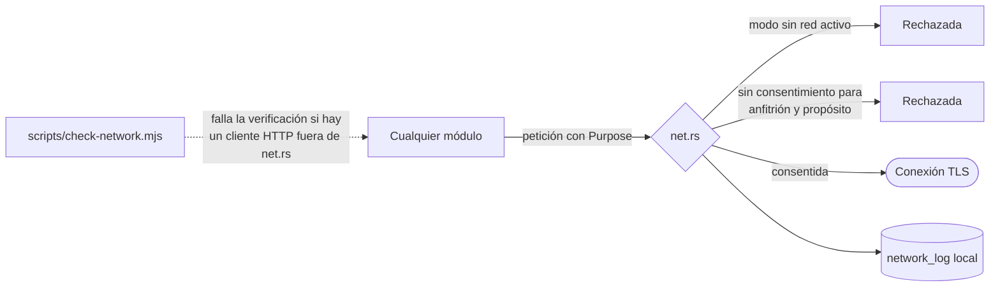

# Auditoría

> **Estado:** Implementado. Esta sección reúne las garantías que un tercero puede **comprobar** sobre el código y
> el binario: qué sale del dispositivo, qué amenazas se consideran, de dónde viene cada dependencia y qué
> rendimiento se exige.

## Documentos

| Documento | Qué permite comprobar |
|---|---|
| [Privacidad y cero telemetría](privacy.md) | Qué datos existen, dónde viven, qué puede salir y bajo qué consentimiento |
| [Modelo de amenazas (STRIDE)](threat-model.md) | Activos, fronteras de confianza, amenazas y mitigaciones, y lo que se declara fuera de alcance |
| [Cadena de suministro](supply-chain.md) | Dependencias, licencias, binarios nativos, firma y procedencia de los artefactos |
| [Pruebas de rendimiento](performance/testing.md) | Cómo se mide y qué presupuestos se exigen |
| [Medición de referencia](performance/baseline-2026-08-26.json) | Cifras de referencia del binario medido |

Los presupuestos numéricos de rendimiento y de almacenamiento derivado están en
[performance-budgets](../architecture/performance-budgets.md).

## Cómo se garantiza la ausencia de telemetría

| Garantía | Mecanismo comprobable |
|---|---|
| No existe telemetría remota | No hay código de analítica ni de informes de fallos; `telemetry.rs` solo escribe archivos locales |
| Toda conexión pasa por una puerta | `scripts/check-network.mjs` rechaza cualquier cliente HTTP fuera de `src-tauri/src/net.rs` |
| Nada sale sin consentimiento | `net.rs` comprueba el modo sin red y el consentimiento por anfitrión y propósito (`network_consents`) |
| Los registros no contienen datos del usuario | `scripts/check-registro.mjs` exige redactar rutas, títulos, autores y texto; la prueba de humo examina el registro real del binario |
| Las extensiones no obtienen capacidades sin permiso | `scripts/check-capacidades.mjs` cruza el mundo WIT con el esquema de permisos |
| Las rutas que llegan del webview se acotan | `scripts/check-rutas.mjs` y `security::resolve_within` |
| Los secretos no se guardan en claro | `secrets.rs` usa el llavero del sistema |

## Cómo auditar una instalación

1. Activar el modo sin red en Ajustes y usar la aplicación: ninguna herramienta de red del sistema
   (`ss -tp`, OpenSnitch, Wireshark) debe registrar conexiones del proceso.
2. Desactivarlo y conceder un único anfitrión: solo ese anfitrión debe aparecer, y solo para el propósito concedido.
3. Revisar los registros en `~/.local/share/nb-books`: no deben contener rutas, títulos ni texto de documentos.
4. Comprobar la publicación con `SHA256SUMS` y `SHA256SUMS.sig` según
   [releases](../developer/deployment/releases.md), sección 6.
