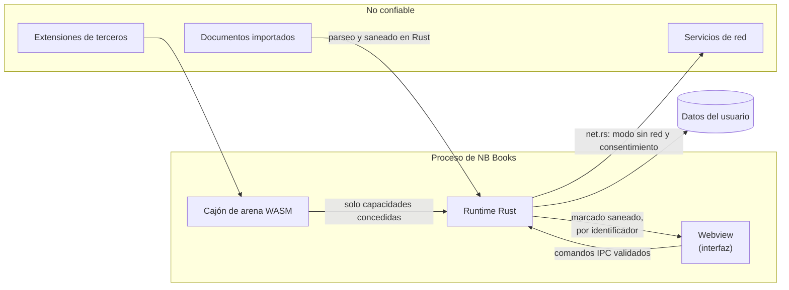

# Modelo de amenazas

> **Estado:** Vigente, con sus mitigaciones implementadas. Se revisa al añadir un componente con acceso a red,
> disco o memoria compartida, y en cada versión mayor.

## 1. Activos

| Activo | Por qué importa |
|---|---|
| Documentos del usuario | Pueden ser material con derechos de autor, confidencial o bajo acuerdo de confidencialidad |
| Anotaciones y notas | Contenido íntimo y trabajo intelectual propio |
| Historial y hábitos de lectura | Revelan intereses, ideología, salud o situación académica |
| Claves de proveedores externos | Coste económico directo para el usuario |
| Integridad del binario y de sus actualizaciones | Ver [supply-chain.md](supply-chain.md) |

## 2. Actores

* Un archivo malicioso importado por el usuario (el vector más probable).
* Una extensión de terceros maliciosa o comprometida.
* Otro usuario o proceso en la misma máquina compartida.
* Un atacante en la red local o un operador de red hostil.
* Un teléfono emparejado perdido, robado o comprometido.
* Un proveedor externo (catálogo, metadatos, IA, voz) como receptor no deseado de contenido.
* Un atacante contra la cadena de construcción, distribución o actualización.

## 3. Fronteras de confianza

## 4. Análisis STRIDE

| Categoría | Amenaza | Mitigación | Dónde |
|---|---|---|---|
| **S**uplantación | Una actualización o un paquete falso se hace pasar por oficial | `SHA256SUMS` firmado con Ed25519 y clave pública compilada en el binario; firma de autor fijada por extensión | `artefactos.rs`, `actualizacion.rs`, `extensions/signature.rs` |
| **S**uplantación | Una extensión se presenta como oficial | Espacio de nombres reservado y nombre del producto rechazados en la revisión | `extensions/review.rs` |
| **T**ampering (manipulación) | Un modelo o voz descargados se alteran en tránsito o en origen | Huella SHA-256 compilada en el binario, comprobada según se descarga; instalación atómica | `ai/instalacion.rs` |
| **T**ampering | Un manifiesto de extensión apunta fuera de su carpeta | Rutas acotadas con `security::resolve_within` | `extensions/registry.rs` |
| **T**ampering | Una ruta que llega del webview escapa del ámbito autorizado | Canonicalización y acotación; guardián `check-rutas.mjs` | `security.rs` |
| **R**epudio | No saber qué salió del equipo y hacia dónde | Registro local de cada intento de salida (`network_log`) y de cada envío a IA (`ai_sends`) | `net.rs`, `ai/envios.rs` |
| **I**nformation disclosure | Fuga de contenido por la red | Una sola puerta, modo sin red, consentimiento por anfitrión, propósito y origen | `net.rs`, `check-network.mjs` |
| **I**nformation disclosure | Fuga de datos en registros o diagnósticos | Redacción obligatoria de rutas, títulos, autores y texto; guardián `check-registro.mjs` | `telemetry.rs` |
| **I**nformation disclosure | Una extensión exfiltra documentos | Cajón de arena sin red ni disco por defecto; permisos declarados y consentidos | `extensions/permissions.rs` |
| **I**nformation disclosure | Inyección de instrucciones que hace al modelo revelar otros documentos | El contenido del documento nunca tiene autoridad; instrucción y fragmentos separados; solo los fragmentos necesarios | [ai/prompts.md](../architecture/ai/prompts.md) |
| **D**enial of service | Bomba de descompresión en EPUB o CBZ | Límites de entradas, tamaño y ratio en `zip.rs` | Sección 5 |
| **D**enial of service | Extensión en bucle o que agota memoria | Plazo por época y límite de memoria por llamada | `extensions.rs` |
| **D**enial of service | Un componente que falla tumba a otro | Monitor de componentes y suite de caos | [chaos.md](../developer/testing/chaos.md) |
| **E**levation of privilege | Script en un EPUB o en un PDF | Saneador con lista de lo permitido aplicado en Rust; PDFium sin JavaScript | `reader/sanitize.rs`, `scripts/fetch-pdfium.mjs` |
| **E**levation of privilege | Código en el webview invoca comandos con parámetros manipulados | Operar por identificador, validar en Rust y capacidades mínimas por ventana | [ipc-contracts.md](../architecture/ipc-contracts.md) |
| **S**uplantación | Alguien en la red local se hace pasar por un teléfono emparejado | `device_token` de 256 bits del que solo se guarda la huella; QR de un solo uso y cinco minutos | `movil/emparejamiento.rs`, `movil/repositorio.rs` |
| **S**uplantación | Alguien en la red local se hace pasar por el PC | El teléfono fija la huella del certificado al emparejar y rechaza cualquier otro | [contrato móvil](../architecture/mobile-contract.md) |
| **I**nformation disclosure | Un teléfono pide lo que no eligió adivinando huellas | Archivos, portadas y manifiesto salen de la misma subconsulta de selección | `movil/manifiesto.rs` |
| **T**ampering | Un teléfono sobrescribe lo que se hizo en el PC | Un dueño y un sentido por tipo de dato: lo que sube solo se suma, y una nota que cambió en el PC entra como copia | `movil/cambios.rs` |
| **E**levation of privilege | Un teléfono que maneja el lector hace algo más que leer | Solo las órdenes de la lista del lector, validadas en Rust y ejecutadas por el registro de comandos; aviso visible y corte en el PC | `movil/control.rs` |
| **E**levation of privilege | Una extensión llama a una capacidad no concedida | Auditoría de importaciones antes de instanciar; cada función del mundo WIT tiene permiso detrás | `check-capacidades.mjs` |

## 5. Superficie de ataque

### 5.1 Archivos maliciosos (PDF, EPUB, CBZ)

* **PDFium sin JavaScript:** `scripts/fetch-pdfium.mjs` obtiene la variante `pdfium-*` y no la `pdfium-v8-*`; la
  biblioteca no exporta ningún símbolo de V8.
* **Parseo en el runtime**, aislado del webview.
* **Saneador de marcado** (`src-tauri/lector/src/reader/sanitize.rs`) con lista de lo permitido, aplicado antes de que el
  marcado llegue al webview: sin scripts, sin recursos remotos, sin navegación fuera del documento. La política de
  contenido del webview es la segunda barrera.
* **MathML de presentación** admitido con sus atributos solo dentro de una fórmula; `annotation-xml` se descarta con
  su contenido y `mglyph` no entra (`tests/epub_lector.rs`).
* **Subconjunto de SVG** sin `script`, sin `foreignObject`, sin animaciones ni filtros y sin referencias externas,
  con una prueba por exclusión.
* **XML sin entidades externas** y con límites de expansión.
* **Rutas dentro de contenedores** validadas: nada se escribe fuera del destino.

Los límites de `zip.rs`, medidos sobre 2.000 EPUB reales leyendo solo el directorio central:

| Medida | Mediana | p99 | Máximo real | Límite | Margen |
|---|---|---|---|---|---|
| Entradas por contenedor | 40 | 226 | 1.921 | 20.000 | 10,4x |
| Mayor entrada descomprimida | 132 KiB | 965 KiB | 11,8 MiB | 64 MiB | 5,4x |
| Contenedor descomprimido | 758 KiB | 9,5 MiB | 47,8 MiB | 512 MiB | 10,7x |
| Mayor ratio de compresión | 6 | 13 | 19 | 150 | 7,9x |

Ninguno de los 2.000 resultó ilegible. Una bomba de descompresión necesita un ratio del orden de 1000:1, así que 150
la detiene sin arriesgar libros legítimos.

### 5.2 Puente IPC

Ver [ipc-contracts.md](../architecture/ipc-contracts.md) y
[authorization.md](../architecture/security/authorization.md): operar por identificador, canonicalizar rutas,
validar en Rust y conceder capacidades mínimas por ventana.

### 5.3 Extensiones

Cajón de arena WebAssembly sin red ni disco por defecto, permisos declarados y consentidos, red concedida por
anfitrión y por extensión, revisión automatizada y firma fijada. Ver [plugin-system.md](../architecture/plugin-system.md).

### 5.4 Máquina compartida

Los datos viven en el directorio del usuario del sistema, con sus permisos. La aplicación no cifra a nivel de
aplicación: frente a otro usuario con privilegios, la protección es el cifrado de disco del sistema operativo. Ver
[encryption.md](../architecture/security/encryption.md).

### 5.5 Red

TLS por defecto con el almacén de confianza del sistema, consentimiento por anfitrión y propósito, consentimiento
aparte para catálogos en claro, y ninguna transmisión de contenido sin consentimiento.

El servidor para NB Books Mobile es lo único que **escucha** en la red, y solo mientras está encendido: HTTPS y
WSS en la red local con certificado propio, únicamente para teléfonos emparejados. Revocar un teléfono le cierra
la puerta en ese momento. Lo que escucha vive en `src-tauri/src/movil/` y `check-network.mjs` impide que algo
escuche en otro sitio. Ver [ADR-016](../adr/016-mobile-companion.md).

### 5.6 Actualizaciones

El actualizador solo consulta las publicaciones del repositorio oficial, solo admite los anfitriones de esas
publicaciones, comprueba la firma de `SHA256SUMS` con la clave compilada y la huella de cada archivo antes de
escribir nada. Ver [releases](../developer/deployment/releases.md).

## 6. Fuera de alcance declarado

NB Books **no** protege contra:

* Un atacante con privilegios de administrador en el equipo.
* Un sistema operativo ya comprometido.
* Análisis forense de memoria mientras un documento está abierto.
* Captura de pantalla o fotografía del contenido mostrado.

Prometer protección que no existe es peor que no prometerla.
