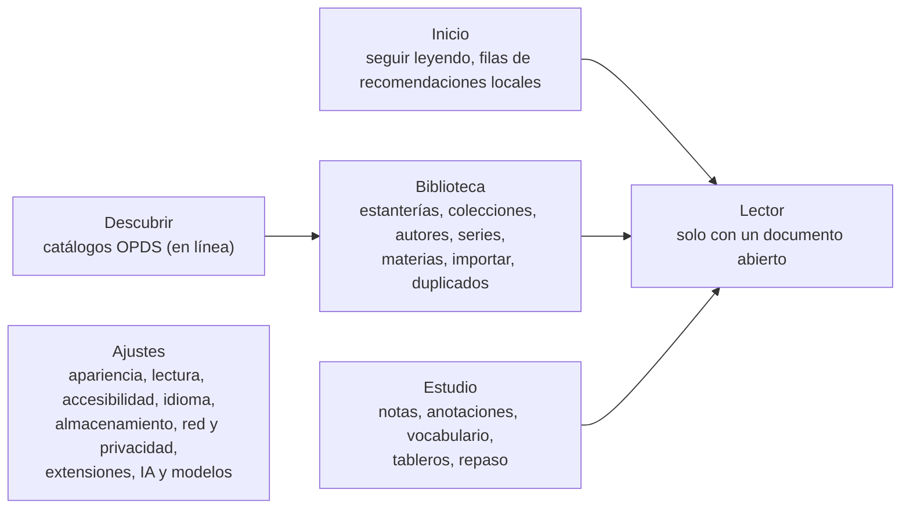

# Diseño

> **Estado:** Implementado. Describe la interfaz tal como la construye `src/lib/ui/`.

## Documentos

| Documento | Contenido |
|---|---|
| [Filosofía de producto](product-philosophy.md) | Los principios que deciden entre dos diseños posibles |
| [Experiencia de lectura](reading-experience/README.md) | Qué hace una persona al leer, qué ofrecen los lectores de referencia y qué se rechazó y por qué |
| [Audio y voz](reading-experience/audio-and-voice.md) | Opciones de lectura en voz alta y sonido de fondo |
| [Convenciones de interfaz](ui-conventions.md) | Movimiento, densidad, filas, títulos, cromo opaco y reglas de hover |
| [Iconos](icons.md) | El catálogo de iconos; nunca emojis ni letras como icono |
| [Marca](branding.md) | Identidad visual y uso del nombre |

La accesibilidad tiene su contrato técnico en [architecture/accessibility](../architecture/accessibility.md) y su
marco normativo en [legal/accessibility-compliance](../legal/accessibility-compliance.md).

## Destinos de la interfaz

La navegación sigue [ADR-013](../adr/013-information-architecture.md): un destino es un lugar que se visita, no
una función que acompaña a otro.

## Tokens visuales y temas

* El sistema de diseño es **Material 3** con `m3-svelte` ([ADR-014](../adr/014-design-system.md)). Los colores
  salen del esquema generado (`src/lib/ui/paletas.css`, generado por `pnpm paletas`) y de `src/lib/ui/tema.ts`;
  ningún componente escribe un color literal, y `scripts/check-ui.mjs` lo impide.
* Los neutros son grises sin croma, comprobados por `tema.test.ts`.
* Hay temas claros y oscuros. El tema **papel** es el claro de partida: fondo cálido de bajo contraste, sin
  animaciones en reposo y con cromo opaco, adecuado para sesiones largas y para pantallas de tinta electrónica.
  El tema **tinta** es su contraparte oscura.
* Los puntos de corte viven en `src/lib/ui/anchos.ts` y no se duplican.

## Flujos principales

| Flujo | Recorrido |
|---|---|
| Primera biblioteca | Ajustes o Biblioteca, Importar, elegir carpeta (referenciada), progreso visible, la biblioteca se llena mientras se indexa |
| Leer | Inicio o Biblioteca, abrir, el lector recuerda la posición; `I` índice, `A` anotaciones, `V` voz, `Ctrl+F` buscar |
| Anotar | Seleccionar con teclado o ratón, `R` resaltar, `S` subrayar, `Enter` anotar, `B` marcador |
| Estudiar | Estudio, notas enlazadas y tableros; repaso espaciado de tarjetas y vocabulario |

Los atajos completos están en la [guía de usuario](../user/shortcuts.md).
