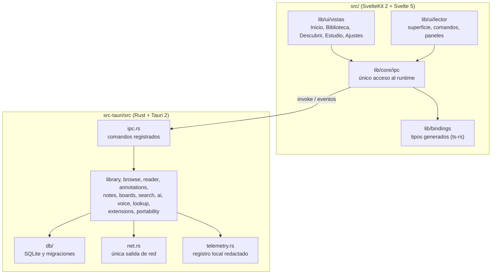

# Documentación para desarrolladores

Cómo se trabaja en el código de NB Books: entorno, estructura, normas, pruebas, integración continua y
empaquetado. El diseño del sistema está en [arquitectura](../architecture/README.md); las reglas que un agente o
una persona deben cumplir sin excepción están resumidas en `AGENTS.md`, en la raíz del repositorio.

## Puesta en marcha

| Documento | Contenido |
|---|---|
| [Setup](setup.md) | Requisitos por sistema y puesta en marcha del entorno |
| [Handbook](handbook.md) | Cómo se razona y se decide en el día a día de ingeniería |
| [Contributing](contributing.md) | Qué se acepta, qué no, y cómo proponer antes de codificar |
| [First PR](first-pr.md) | Guía paso a paso para la primera contribución |

## Estructura del código

| Directorio | Contenido |
|---|---|
| `src/lib/core/ipc` | Único punto que invoca el puente. Un lint impide llamarlo desde otro sitio |
| `src/lib/bindings` | Tipos generados desde Rust con `ts-rs`. No se editan |
| `src/lib/ui` | Sistema de diseño, componentes, vistas y lector |
| `src/lib/i18n` | Catálogos de español, inglés y portugués |
| `src-tauri/src` | Un módulo por servicio; ver el mapa en `AGENTS.md` |
| `src-tauri/migrations` | SQL embebido. Una migración publicada no se edita |
| `src-tauri/tests` | Integración, caos, humo del binario y pruebas sobre corpus reales que se omiten sin ellos |
| `e2e` | Recorridos de interfaz con Playwright: flujo, accesibilidad y rendimiento |
| `scripts` | Guardianes de la verificación y herramientas de empaquetado y procedencia |
| `extensiones` | Extensiones propias y banco de extensiones adversas |

## Normas y flujo

| Documento | Contenido |
|---|---|
| [Coding standards](coding-standards/README.md) | Nombres, formato, errores, registro y documentación del código |
| [Git workflow](git-workflow.md) | Ramas y estrategia de fusión |
| [Commit convention](commit-convention.md) | Conventional Commits y DCO |
| [Code review](code-review.md) | Qué se revisa y cómo se comenta |

## Pruebas

| Documento | Contenido |
|---|---|
| [Testing](testing/README.md) | Estrategia general y pirámide de pruebas |
| [Unit](testing/unit.md), [Integration](testing/integration.md), [Contract](testing/contract.md) | Niveles de prueba y contrato del puente |
| [Chaos](testing/chaos.md) | Fallo de un componente sin arrastrar a otro |
| [Regression](testing/regression.md) | Una prueba por defecto corregido |
| [Screen readers](testing/screen-readers.md) | Procedimiento con lectores de pantalla |

Las pruebas de rendimiento están en [audit/performance](../audit/performance/testing.md).

## Integración y distribución

| Documento | Contenido |
|---|---|
| [CI/CD](ci-cd.md) | Flujos de verificación y de ediciones |
| [Releases](releases.md) | Versionado y corte de versiones |
| [Deployment](deployment/README.md) | Empaquetado por plataforma, firma y comprobación de publicaciones |
