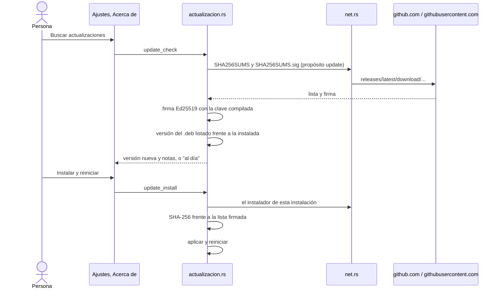

# Publicaciones y actualizaciones

> **Estado:** Implementado. Linux verificado en equipo real; Windows y macOS se publican sin probar. Firma y procedencia de los artefactos (`src-tauri/src/artefactos.rs`,
> `scripts/procedencia.mjs`) y actualizador integrado (`src-tauri/src/actualizacion.rs`). El corte de versiones
> está en [developer/releases.md](../releases.md).

## 1. Canales

| Vía | Para quién |
|---|---|
| Publicaciones del repositorio `nb-digital-hq/nb-books` en GitHub | Fuente primaria y verificable |
| Actualizador integrado (Ajustes, Acerca de) | Quien usa la aplicación |
| NB Launcher | Quien gestiona las aplicaciones de NB Digital desde el Launcher; instala y actualiza el `.tar.gz` |
| Repositorios internos de una organización | Áreas de TI, a partir de los `.deb` y `.rpm` publicados |

## 2. Qué publica cada versión

* Los instaladores de Linux: `.deb`, `.rpm`, AppImage y `.tar.gz`, construidos en local.
* Los instaladores de las demás ediciones, construidos por `ediciones.yml` en GitHub Actions y marcados **sin
  probar**: Windows universal, rápida (AVX2) y con CUDA (`-setup.exe` y `.msi`), macOS en Apple Silicon normal y con
  Metal (`.dmg`), y Linux con CUDA (`.deb` y `.rpm`). No llevan firma de Apple ni de Microsoft. Las de CUDA
  necesitan en el equipo el controlador de NVIDIA y las bibliotecas de CUDA 12 (cuBLAS, cuRAND y NVRTC): enlazan con
  ellas y no las traen.
* `NOTAS.md`, con la sección de esa versión en `CHANGELOG.md`.
* El listado de componentes con sus licencias, en CycloneDX 1.5.
* `THIRD-PARTY-NOTICES.md`.
* `launcher-catalog.json` y su firma `launcher-catalog.json.sig`, para NB Launcher (sección 3.1).
* `SHA256SUMS`, con la huella de todo lo anterior, y su firma `SHA256SUMS.sig` (Ed25519).

Cada instalador lleva las dos ediciones del programa: la universal y la rápida, solo para procesadores compatibles
con AVX2. Al arrancar se usa la rápida si el procesador la admite.

## 3. Actualizador integrado



* **Nunca busca solo.** Pulsar el botón es el consentimiento para el propósito `update` en `github.com` y en
  `*.githubusercontent.com`, la red de descargas a la que GitHub redirige, que la interfaz nombra junto al botón.
  Cualquier otro anfitrión se rechaza, y el modo sin red lo impide todo.
* **La confianza viene de la clave compilada.** `SHA256SUMS` tiene que llevar la firma Ed25519 de la clave pública
  que viaja dentro del binario; cada archivo descargado se compara con su huella de la lista antes de escribir nada.
  Una firma o una huella que no cuadran abortan con `DOCUMENT_CORRUPTED`.
* **Se instala según cómo se instaló:**

| Instalación | Cómo se actualiza |
|---|---|
| AppImage (`$APPIMAGE`) | Se escribe el nuevo al lado y se sustituye por renombrado atómico |
| `.tar.gz` en una carpeta del usuario | Se extrae al lado, se comprueba que trae `bin/nb-books` y se intercambian las carpetas |
| `.deb` en `/usr` | `pkexec dpkg -i`, que pide permiso en una ventana del sistema |
| `.rpm` en `/usr` | `pkexec rpm -U` |
| Otra | `COMPONENT_UNAVAILABLE`: se actualiza con el gestor de paquetes o descargando la versión nueva |

* Tras instalar, la aplicación se reinicia con la versión nueva.
* **Una copia de NB Launcher no se actualiza sola.** Si junto al ejecutable está la marca `.nb-launcher-managed`,
  el actualizador no consulta la red y Ajustes dice que las actualizaciones las hace el Launcher: sustituir archivos
  que el Launcher comprueba byte a byte haría que diera la copia por dañada.

### 3.1 NB Launcher

El Launcher instala, actualiza y quita una copia de NB Books con su contrato `books_linux_v1` sobre el `.tar.gz`
(raíz `nb-books-<versión>-linux-x86_64`, ejecutables `bin/nb-books` y `bin/nb-books-avx2`). Lo que descarga lo
autentica con `launcher-catalog.json`: esquema 1, propietario `nb.books`, repositorio `nb-digital-hq/nb-books`, los
cuatro formatos Linux con tamaño, SHA-256 y firma, y caducidad a los catorce días. Catálogo y artefactos van firmados
con la clave minisign de NB Books, cuya parte pública es `docs/architecture/api/clave-del-launcher.pub` y viaja
también en el Launcher. Es otra clave que la de `SHA256SUMS`, por el mismo motivo que la de las extensiones.
* En equipos gestionados se recomienda no usar el actualizador y publicar los paquetes verificados en el
  repositorio interno ([institution/deployment.md](../../institution/deployment.md)).

## 4. Compatibilidad de datos entre versiones

Una actualización nunca debe dejar la biblioteca del usuario inutilizable.

* Las migraciones son incrementales y hacia adelante (ver
  [migrations.md](../../architecture/migrations.md)).
* Antes de una migración que no sea trivial, la aplicación crea una copia de seguridad de la base de datos y
  informa dónde quedó.
* Si el usuario instala una versión anterior a la que generó la base de datos, la aplicación debe detectarlo,
  negarse a operar sobre ella y explicar por qué, en lugar de intentar leerla y corromperla.

## 5. Retirada de una versión

Si una versión publicada resulta defectuosa:

1. Se publica de inmediato una versión de corrección, que es lo que verá el actualizador.
2. Se marca como no recomendada en la página de releases, sin borrarla (los usuarios ya la tienen instalada y
   necesitan poder identificarla).
3. Se publica una corrección hacia adelante y una nota pública con el impacto.

## 6. Cómo comprobar una publicación

Para quien administra equipos y quiere saber, antes de instalar, que lo que descargó es lo que el proyecto
publicó. No hace falta compilar nada ni instalar NB Books: bastan `sha256sum` y `openssl` 3 o posterior.

Una publicación es una carpeta con estos archivos:

| Archivo | Qué es |
|---|---|
| `nb-books_<versión>_amd64.AppImage`, `.deb`, `nb-books-<versión>-1.x86_64.rpm` y `nb-books_<versión>_linux-x86_64.tar.gz` | Los instaladores de Linux |
| `nb-books_<versión>_windows-x64[-avx2\|-cuda]-setup.exe` y `.msi`, `nb-books_<versión>_macos-arm64[-metal].dmg`, `nb-books_<versión>_linux-x86_64-cuda.*` | Los instaladores de las ediciones sin probar |
| `nb-books_<versión>.cdx.json` | El listado de componentes con sus licencias, en CycloneDX 1.5. Dice de qué commit salió |
| `NOTAS.md` | Las notas de la versión |
| `THIRD-PARTY-NOTICES.md` | Los avisos de terceros |
| `SHA256SUMS` | La huella de cada uno de los anteriores |
| `SHA256SUMS.sig` | La firma de esa lista: 64 bytes de Ed25519 |

**La clave pública no viene en la carpeta, y eso es deliberado**: quien pudiera cambiar un instalador podría
cambiar una clave que viajara con él. Está en el repositorio, en `docs/architecture/api/clave-de-publicacion.pem`, y hay que
tomarla de ahí.

Con la clave guardada como `clave-de-publicacion.pem` fuera de la carpeta, y dentro de la carpeta:

```bash
# 1. La lista de huellas es la que firmó el proyecto.
openssl pkeyutl -verify -pubin -inkey ../clave-de-publicacion.pem \
  -rawin -in SHA256SUMS -sigfile SHA256SUMS.sig

# 2. Cada archivo es el que la lista dice.
sha256sum --check --strict SHA256SUMS
```

La primera tiene que responder `Signature Verified Successfully` y la segunda, `OK` (o `La suma coincide`) en
cada línea. **Las dos, y en ese orden**: la segunda sin la primera solo dice que los archivos coinciden con una
lista que pudo escribir cualquiera.

Lo que estas dos órdenes no miran es si en la carpeta hay algún archivo **que la lista no nombra**. Si se
descargó un solo instalador no importa; si se descargó la carpeta entera, se compara a ojo con la tabla de arriba.

### 6.1 Cómo se firma, para quien publica

```bash
# Una sola vez. La clave privada no se sube a ningún sitio ni se copia a este repositorio.
cd src-tauri
cargo run --features herramientas --bin firmar -- --crear-clave <ruta-fuera-del-repositorio>/publicacion.pkcs8
cargo run --features herramientas --bin firmar -- --clave-publica-pem <esa-ruta> > ../docs/architecture/api/clave-de-publicacion.pem
# La clave pública se confirma en el repositorio: es lo que usa quien verifica.

# En cada versión, con el árbol limpio y el commit ya subido.
gh workflow run ediciones.yml --ref main          # y esperar a que termine en verde
gh run download <ejecución> --dir <carpeta-de-ediciones>
NO_STRIP=1 pnpm empaquetar:linux
pnpm procedencia --clave <esa-ruta> --clave-launcher <clave-minisign-fuera-del-repositorio> \
  --ediciones <carpeta-de-ediciones>
```

La clave minisign del Launcher se crea una sola vez con `pnpm tauri signer generate -w <ruta>`; su `.pub` se copia a
`docs/architecture/api/clave-del-launcher.pub` y al Launcher (`distribution/books.pub`). `pnpm procedencia` se niega
a firmar con otra.

`pnpm procedencia` deja la carpeta en `src-tauri/target/publicacion/<versión>/`, la firma y **la comprueba contra
la clave del repositorio**, no contra la que acaba de usar: si no son la misma, falla ahí y no después de publicar.

**La clave de publicación no es la de las extensiones.** Son dos pares distintos a propósito: perder o exponer
una no compromete lo que firma la otra.
