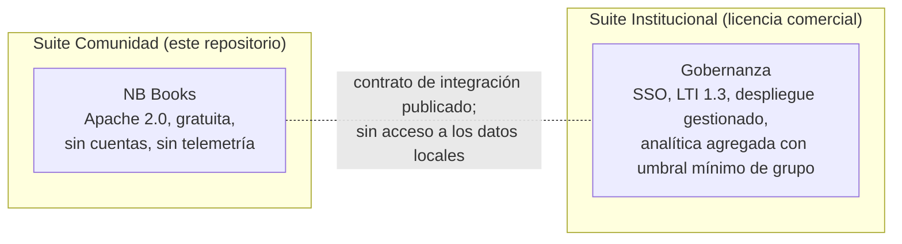

# NB Books para instituciones

> **Audiencia:** dirección académica, bibliotecas, áreas de tecnología, jurídicas y de cumplimiento.

NB Books es una aplicación de lectura, gestión documental y estudio que funciona por completo en el equipo de
cada persona. Esta sección explica qué garantiza a una institución que la adopta, cómo se despliega y cómo se
relaciona con la oferta institucional del ecosistema NB Digital.

## Documentos

| Documento | Para qué sirve |
|---|---|
| [Resumen ejecutivo](executive-summary.md) | Qué es, qué problema resuelve y por qué es una adopción de bajo riesgo |
| [Despliegue](deployment.md) | Paquetes, instalación desatendida, configuración y actualizaciones en equipos gestionados |
| [Cumplimiento y protección de datos](compliance.md) | Qué datos trata la aplicación, dónde viven y qué puede afirmar la institución ante una auditoría |
| [Integración institucional](integration.md) | Modelo de la Suite Institucional: LMS (LTI 1.3), SSO, gestión de flotas y analítica agregada anónima |

## Dos suites sobre la misma base

* **La aplicación es completa para la persona.** Ninguna función de lectura, anotación, búsqueda, estudio o IA
  local se reserva a una edición de pago.
* **La institución paga por gobernanza, no por funciones.** Identidad centralizada, integración con el sistema de
  gestión del aprendizaje, despliegue desatendido y cumplimiento auditable pertenecen a la Suite Institucional, que
  se licencia por separado y no forma parte de este repositorio.
* **La frontera es técnica, no comercial.** La aplicación no envía a ninguna institución progreso, anotaciones ni
  actividad. Ver [cumplimiento](compliance.md).
