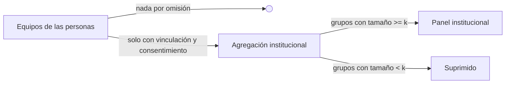

# Integración institucional

> **Audiencia:** TI, plataformas de aprendizaje y seguridad de la información.

Las capacidades de gobernanza pertenecen a la **Suite Institucional** de NB Digital, que se licencia por separado
bajo licencia comercial. Esta aplicación, distribuida bajo Apache 2.0, no las contiene, no requiere ninguna de ellas
para funcionar y no envía datos a ningún servicio institucional. Este documento describe el modelo para que una
institución sepa qué esperar de cada parte.

## 1. Sistemas de gestión del aprendizaje (LTI 1.3)

El contrato de integración con Canvas, Moodle, Blackboard y equivalentes es **LTI 1.3 / LTI Advantage**: un solo contrato estándar,
certificable y sin dependencia de un proveedor, frente a la integración directa con la API de un LMS concreto.

## 2. Identidad centralizada (SSO)

La identidad corporativa (SAML 2.0, OpenID Connect, Azure AD, Okta) se resuelve en el servicio institucional. La
aplicación de la persona no inicia sesión en nada para funcionar; la vinculación con una institución es una
elección explícita que no desbloquea funciones, solo contenidos y espacios del curso.

## 3. Despliegue gestionado

La Suite Institucional añade repositorios gestionados, políticas de configuración y soporte de despliegue. Lo que
ya permite esta aplicación sin licencia adicional está en [despliegue](deployment.md).

## 4. Analítica agregada anónima ($k$-anonimato)

* Solo se publican indicadores de grupos cuyo tamaño alcanza el umbral $k$ fijado por contrato.
* Nunca se exponen anotaciones, notas, títulos leídos ni actividad individual.
* La institución conoce, por ejemplo, el grado de participación de una cohorte, nunca lo que lee una persona.

## 5. Modelo de confianza

Un servicio institucional nunca es de confianza para el contenido personal: no puede leer la biblioteca, las
anotaciones ni las notas de un equipo, porque esta aplicación no se las envía.
